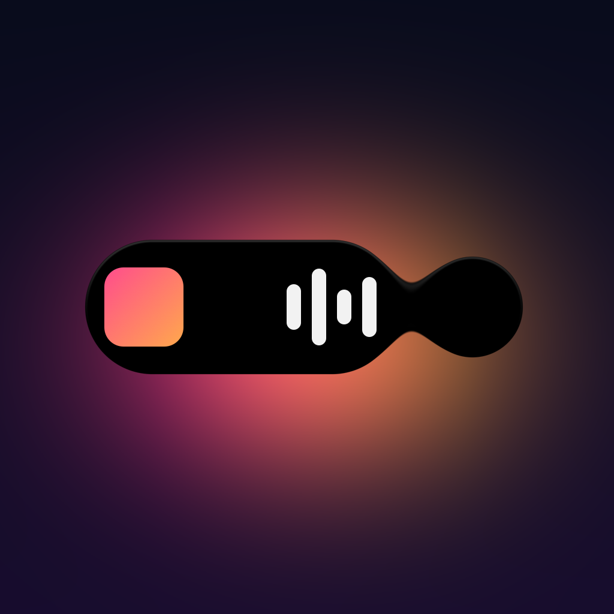
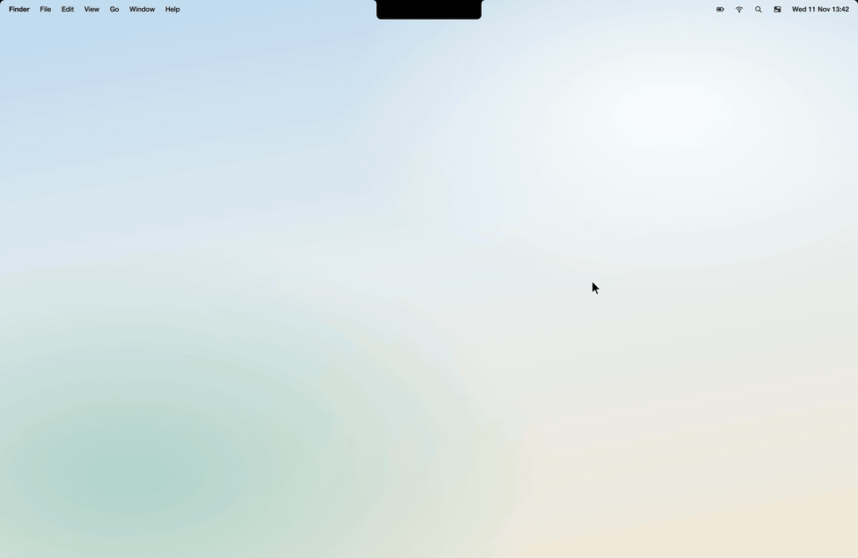
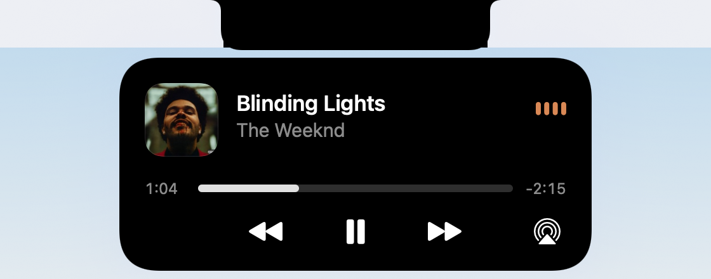
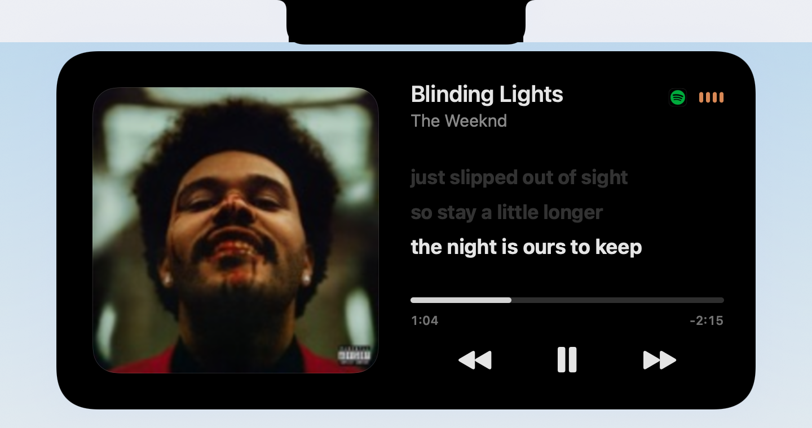
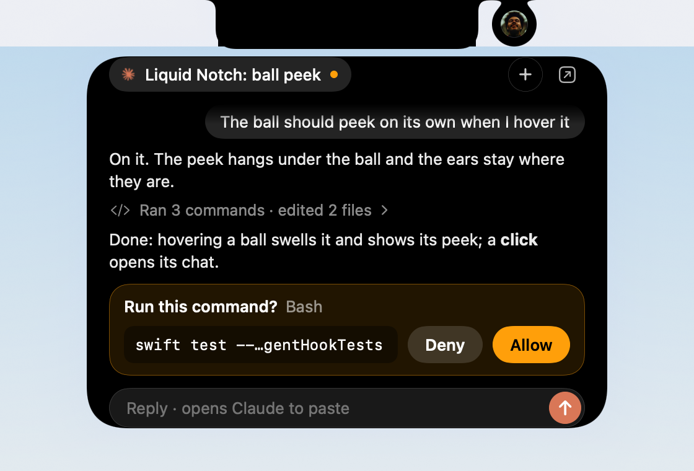
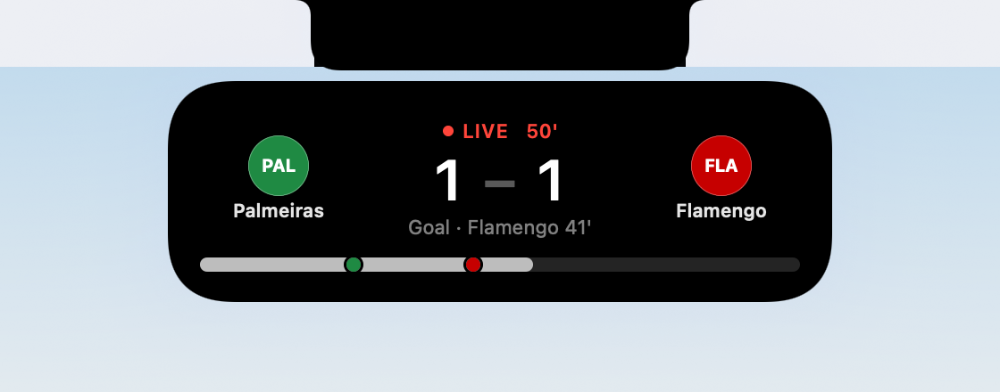
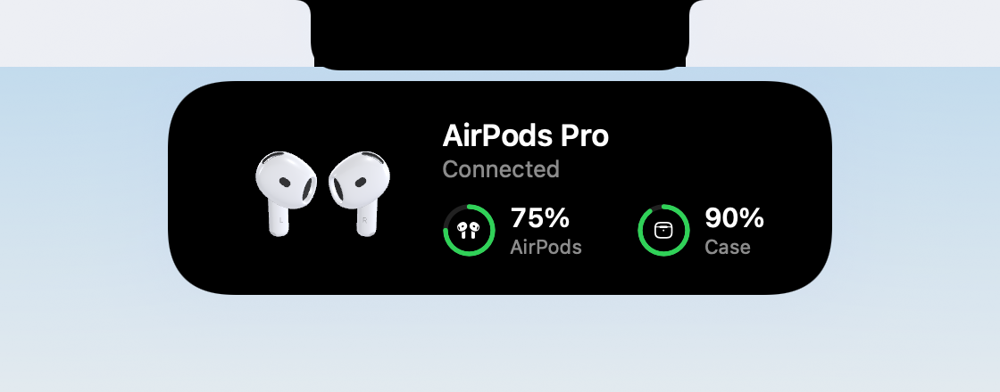
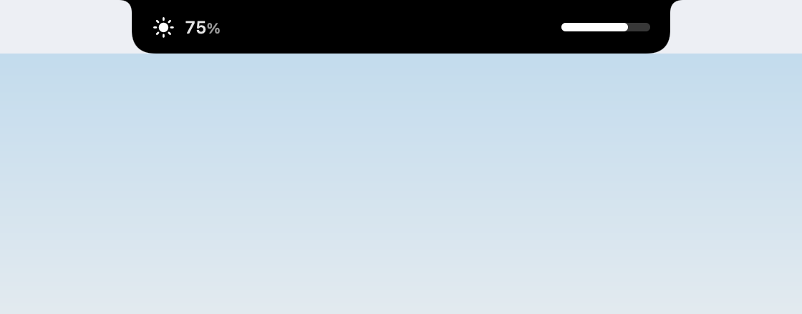

<p align="center"></p>

<h1 align="center">Liquid Notch</h1>

<p align="center"><b>Your MacBook's notch, finally behaving like the Dynamic Island.</b><br>
A liquid shape that pours, stretches and splits, with your album art's glow around it. Not a black box tracing the notch.</p>

<p align="center">
  <a href="../../releases/latest"></a>
  <a href="../../releases/latest"></a>
  
  
  <a href="LICENSE"></a>
</p>

<p align="center"></p>
<p align="center"><sub>The full demo, in 60 fps: <a href="../../releases/latest">demo.mp4 on the release page</a>.</sub></p>

<table>
  <tr>
    <td width="50%"><br><b>The player.</b> Seek, skip, AirPlay. Hover the ears for a quick preview.</td>
    <td width="50%"><br><b>Synced lyrics.</b> Click the cover; the line being sung stays in the middle.</td>
  </tr>
  <tr>
    <td><br><b>Claude Code and Codex.</b> Allow, deny or answer without leaving what you're doing.</td>
    <td><br><b>Your teams, live.</b> Football, NFL, NBA, MLB and NHL.</td>
  </tr>
  <tr>
    <td><br><b>AirPods.</b> Real 3D buds and their battery when they connect.</td>
    <td><br><b>Volume and brightness.</b> The notch's own HUD, and you can drag it.</td>
  </tr>
</table>

## What it does

- **Music in the ears beside the notch**: cover on the left, bars that move with what's playing on the right. Hover for a preview, click for the player (seek, AirPlay), click the cover for synced lyrics.
- **A video too**: when a video plays beside your music, it waits in a ball. Click it, then its card, and **watch the video right in the island**, or pop it out into **picture in picture** and drag it anywhere. It leaves the island while you're on its own tab.
- **Claude Code and Codex**: a ball per agent while it works. Approve or deny a permission, or answer its question, right from the notch. Ask either one about your screen with ⌥Space (Ask uses your own installed Claude Code or Codex, signed in with your account).
- **Activities, iPhone-style**: charging and low battery, AirPods with their battery, your next meeting with its Join link, timers, downloads, Focus, the camera light, screen recording from the notch.
- **Sports**: follow teams in football (soccer), the NFL, NBA, MLB and NHL. A reminder before the game, the live score, goals as they happen, the final.
- **Volume and brightness**: replaces the system HUD with one you can drag.
- **A tray of tools** (double-click the notch): Timer, Record, Focus (it knows which Focus is on), Clipboard, a Shelf for files, Shortcuts.
- **On the lock screen**: the song gets its own card, and optionally its art becomes the lock screen's background (your wallpaper is backed up and always put back).
- **Notifications**, if you want them: each one opens in the notch for a few seconds, then goes.
- **It knows where you are**: it steps aside for fullscreen video, open menus and presentations, and never pops a card open while you're typing.

Every one of these is optional, and most are off until you turn them on in Setup.

## Install

**Download**: grab `Liquid-Notch-1.0.zip` from [Releases](../../releases), unzip it, and move **Liquid Notch** to Applications.

The app isn't notarized yet, so the first time macOS will say it can't check it. Either right-click the app › **Open** › **Open**, or run:

```sh
xattr -dr com.apple.quarantine "/Applications/Liquid Notch.app"
```

**Build from source** (Xcode 16 or later, Swift 6):

```sh
git clone https://github.com/fellipegoncalvesleite/liquid-notch.git && cd liquid-notch
tools/build_adapter.sh      # the Now Playing adapter (needs only clang)
./build_app.sh              # → dist/Liquid Notch.app
open "dist/Liquid Notch.app"
```

There's no menu bar icon: **right-click the notch** for the app's menu (Setup, timers, Open at Login, Quit). Opening the app again shows Setup.

## Permissions, and why

Setup asks for each one up front, never in the middle of something. Skip any you don't want; only that feature goes away.

| Permission | What it's for |
|---|---|
| **Automation** (Music, Spotify) | Play, pause, skip and seek when Now Playing can't be read directly, and open the song in its app |
| **Accessibility** | Replacing the volume and brightness HUD, the ⌥Space shortcut, call banners |
| **Bluetooth** | AirPods connecting and their battery |
| **Calendar** | Your next meeting and its Join link |
| **Focus** | Whether a Focus is on (only on or off, never which) |
| **System audio** (Screen & System Audio Recording) | Bars that move with the music. Nothing is recorded or kept. Without it the bars animate |
| **Screen Recording** | Recording your screen from the notch, watching a video in the island, and the screenshot Ask can send |
| **Full Disk Access** | Reading new Messages, which Focus is on, and notifications if you turn them on. All optional |

## Privacy

Everything happens on your Mac. The only things that go out are:

- **ESPN**, for team search, schedules, scores and crests, and only once you follow a team.
- **LRCLIB** ([lrclib.net](https://lrclib.net)), for lyrics: the song's title and artist, only when you open the lyrics.
- **Ask**, when you use it: your question (and a screenshot, if Screen is on) goes to Anthropic or OpenAI through your own installed Claude Code or Codex, under your own account.

No analytics, no accounts, no update pings.

## Claude Code and Codex

Turning on **Watch Claude and Codex** in Setup adds one small hook per event to `~/.claude/settings.json` and `~/.codex/hooks.json`. Both files are backed up first (`<name>.liquid-notch-backup-<time>`), and your other hooks are left alone. The hook is a shell script (`~/Library/Application Support/Liquid Notch/agent-hook.sh`) that tells the notch what the agent is doing over a local socket.

It's **fail-open**: if Liquid Notch isn't running, the hook exits at once and your agent carries on as if it weren't there. Only a permission request or a question waits for you, and only up to its timeout, after which the agent asks you itself as usual.

To remove it, turn the switch off in Setup: the hooks and the script are taken out. To do it by hand, delete the entries that mention `agent-hook.sh` from those two files.

## Requirements

- A MacBook with a notch (MacBook Pro 14"/16" 2021 or later, MacBook Air M2 or later). Nothing shows on a Mac without a notch, or with the lid closed.
- macOS 15 Sequoia or later.

## Credits

- Now Playing through [mediaremote-adapter](https://github.com/ungive/mediaremote-adapter) by Jonas van den Berg (BSD 3-Clause), vendored in `Vendor/`.
- AirPods 4 3D model by Falah3D, [CC BY 4.0](https://creativecommons.org/licenses/by/4.0/). Studio lighting "Studio Small 08" from [Poly Haven](https://polyhaven.com), CC0.
- Lyrics from [LRCLIB](https://lrclib.net). Scores from ESPN's public site API (unofficial).
- Album covers in the demo and screenshots belong to their artists and labels. The video in the demo is *Big Buck Bunny* (© Blender Foundation, [CC BY 3.0](https://creativecommons.org/licenses/by/3.0/)).
- Not affiliated with Apple, Anthropic, OpenAI or ESPN.

## License

[MIT](LICENSE)

## Support

Liquid Notch is free and always will be. If it made your notch a little nicer and you'd like to say thanks:

<a href="https://www.paypal.com/ncp/payment/8ZCX7UBTXTXXN"></a>
